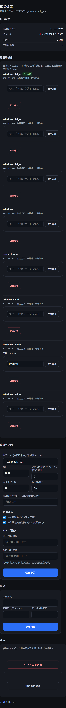

# DSH 局域网远程网关

[](https://github.com/carbon-wolf/dsh-lan-gateway/actions/workflows/ci.yml)
[](LICENSE)

给 **DeepSeek Harness 桌面版** 加一个带密码的局域网入口：手机、平板、另一台电脑的浏览器，直接接着用桌面版里**同一个** Host——相同的会话列表、进行中的任务、文件树和审批弹窗。相当于把桌面端变成可远程操作的服务，而不复制一份数据。

> 桌面版本身就是一个 Web 应用（Electron 壳 + `dsh web`），只是它把 HTTP 服务绑在 `127.0.0.1` 的随机端口上，并且用一个进程级随机 token 保护。本网关做的三件事：**找到那个端口**、**用持久化 secret 铸造合法会话**、**把 Host/Origin 改写成 Host 认可的形式**。数据始终只有一份。

---

## 适用环境

| 项 | 要求 |
|---|---|
| 系统 | Windows 10 / 11（端口发现用 WMI，其它平台目前不适用） |
| DeepSeek Harness | 桌面版 0.2.2-rc.3（菜单/插槽注入依赖该版本 DOM，其它版本可能需要在 `inject/` 里微调） |
| Node.js | 20 或更高（网关本体和脚本都用标准库，**零第三方依赖**） |
| 浏览器 | 手机/桌面现代浏览器；移动端布局针对窄屏做了适配 |

## 快速开始

```bat
setup.cmd
```

按提示选择**给手机访问的网卡地址**、端口（默认 3080）、设置网关密码（直接回车自动生成），再决定是否随开机启动。脚本会写好配置、启动守护进程，并打印手机访问地址。

手机与电脑连同一 WiFi → 打开打印的地址 → 输入密码。

| 操作 | 命令 |
|---|---|
| 后台运行网关 | `start-gateway-background.cmd` |
| 前台运行（看日志） | `start-gateway.cmd` |
| 守护进程（检测到桌面版就拉起网关） | `start-watcher.cmd` |
| 停止网关 | `stop-gateway.cmd` |
| 开机自启 / 取消 | `install-autostart.cmd` / `remove-autostart.cmd` |
| 所有设备强制退出 | `lock-all.cmd` |
| 改密码 | `set-password.cmd` |
| 移动端渲染核验（需密码） | `verify.cmd <密码>` |

日志：`gateway\logs\`；健康检查：`http://<IP>:3080/_gw/healthz`。

## 界面


**桌面端入口**：左侧栏账号菜单（点左下角头像）里新增两项，紧跟原生菜单项，图标与主题一致：

```
设置   Ctrl+Alt+,
意见反馈
网关设置          ← 新增
锁定网关          ← 新增
退出登录
```

**设置页** `/_gw/settings`（登录后可访问）：



- 运行状态：桌面版 Host 端口、访问地址、运行时长、已吊销会话数
- **已登录设备**：设备/浏览器识别（`iPhone · Safari`、`Mac · Chrome`、`Windows · Edge`…）、IP、最后活跃、过期时间、备注；可单独**登出**
- 监听与访问：监听地址、端口、登录保持（**0–90 天，0 = 不自动退出**）、连续失败上限、锁定分钟、桌面 Host 端口
- 页面注入开关、TLS 证书路径
- 密码修改、轮换签名密钥（所有设备退出）、锁定本设备

## 功能

- **同一份数据**：反向代理到桌面版正在跑的 Host，不启动第二个 DSH 进程。
- **密码保护**：scrypt 哈希 + HMAC 签名 cookie（`HttpOnly; SameSite=Lax`），失败限速与锁定。
- **锁定/退出**：账号菜单或输入区图标 → 服务端吊销该会话（复制的 cookie 立即失效）。
- **设备管理**：看到哪台设备登录过、加备注、单独踢下线；`lock-all.cmd` 一次清空所有设备。
- **自动拉起**：守护进程发现桌面版在运行就启动网关；桌面版换端口自动跟随。
- **移动端适配**：视口/安全区/输入缩放修正 + 触摸设备隐藏 hover 元素。
- **零依赖**：只用 Node 标准库，不安装任何 npm 包，不读写 `app.asar`。

## 原理

1. 桌面版 Host 由 `dsh-desktop-host` 以 `--host 127.0.0.1 --port 0` 启动（`@deepseek-ai/dsh-desktop-host/lib/index.js`），端口随机。
2. 它的浏览器 cookie 由 `HMAC-SHA256(secret, payload)` 签发，`secret` 明文保存在 `~/.dsh/.credentials.yaml` 的 `client-connection/browser-session`（见 `gateway/dsh-auth.mjs`）。网关只读该文件，按上游 authority 铸造合法 cookie，于是拥有 owner 权限。
3. `/api` 的信任栅栏要求 Host 为 loopback、Origin 同源（`@deepseek-ai/dsh-client-connection/src/api-request-trust.ts`）。网关把 `host` 改写为 `127.0.0.1:<port>`，`origin`/`referer` 同步改写，`sec-fetch-site` 原样保留。
4. 传输是 WebSocket（`/api/...`），网关的 `upgrade` 分支双向透传，第三方面板的 `/sidebar/ws/...` 同样可用。
5. HTML 响应会被解压、注入移动端样式与控制按钮、重新压缩；其余请求全部流式转发（大文件不落内存）。

## 实测记录（本机，2026-11-16）

- 端口自动发现：`127.0.0.1:<随机端口>`（WMI）。
- 未登录 `GET /` → 401/跳登录页；错误密码 8 次 → 429；正确密码 → `Set-Cookie`。
- `POST /api/...` 携带网关 cookie → 上游 `404 not found`（已过 Host 与 cookie 校验）；不带 → 401。
- WebSocket：`/api/remote.mux` 与 `/sidebar/ws/agent-opens?...` 均 101 成功。
- headless Edge（iPhone UA）390×844 与 820×1180：`overflowX = 0`，`data-dsh-mobile` 生效。
- 账号菜单注入后项序 `设置 / 意见反馈 / 网关设置 / 锁定网关 / 退出登录`，宽度保持 144px。
- 锁定后同一 cookie 复用 → 401；设置页「登出这台」→ 该会话下一次请求 401，其它设备不受影响。
- `sessionDays=0` 保存为长期有效，`91` 被拒绝并提示 0–90。
- 守护进程：手动结束网关后 12 秒内自动拉起。

## 安全模型

- 网关只监听一个具体网卡地址；桌面版 Host 始终只绑 `127.0.0.1`，局域网无法直连。
- **拿到密码 = 完整 owner 权限**（可以执行命令、修改文件）。仅用于可信局域网，不要做公网端口映射。
- 默认 HTTP 明文，同网段可嗅探内容；需要加密时在设置页填 TLS 证书与私钥。
- `gateway/auth.json`（密码哈希 + 签名密钥）与 `gateway/sessions.json`（会话签名）等同凭据，均已在 `.gitignore` 中排除。
- 会话默认 30 天有效；填 0 则长期有效（浏览器上限 400 天），适合个人手机。

## 已知限制

- 仅 Windows：端口发现依赖 WMI 查询 `dsh-desktop-host` 进程。
- 必须运行桌面版；桌面版退出后网关返回“桌面版未就绪”。
- 手机与桌面共享同一个 owner peer：同一会话两端同时输入会互相打断，接管时先在桌面停下。
- 首次用新浏览器打开可能遇到插件自己的弹窗（例如第三方插件的用户须知），点掉即可。
- 窄屏下会话列表默认收起，用顶栏左侧图标展开（官方布局行为）。

## 排障

| 现象 | 处理 |
|---|---|
| 手机打不开（超时） | 管理员运行 `install-firewall.cmd`；确认同网段；设置页确认监听地址是本机当前 IP |
| 502「桌面版未就绪」 | 桌面版没运行；或在设置页把 Host 端口写死 |
| 登录后立刻 401 | `~/.dsh/.credentials.yaml` 缺 `client-connection/browser-session`；打开一次桌面版让它重建，网关 60 秒内自愈 |
| 页面空白或样式异常 | 设置页关闭“页面注入”两项后重启网关 |
| 忘了密码 | 设置页用当前密码修改；彻底忘记就删 `gateway\auth.json` 重启，日志会打印临时密码 |
| 菜单里没有新增项 | DOM 变了：用 `node verify/probe-menu.mjs` 看当前结构，必要时调整 `inject/mobile.js` 的选择器 |

## 目录

```
gateway/server.mjs         认证 / 反代 / WS 透传 / HTML 注入 / 端口发现 / 会话吊销 / 设置页
gateway/dsh-auth.mjs       读取 credentials 中的 secret，铸造 Host 浏览器 cookie
gateway/discover.mjs       定位桌面版 Host 的 loopback 端口（WMI + 兜底探测）
gateway/config.json        运行配置（setup.cmd 生成，不入库）
gateway/auth.json          密码哈希与签名密钥（不入库，勿外传）
gateway/sessions.json      已登录设备登记表（不入库，勿外传）
inject/mobile.css          移动端注入样式
inject/mobile.js           移动标记、账号菜单注入、窄屏控制图标
watch-gateway.mjs          守护进程：桌面版在跑就拉起网关
setup.mjs                  一键安装（选网卡、设密码、可选自启、启动守护）
_node.cmd                  解析 Node 路径
*.cmd                      启停 / 自启 / 改密 / 锁全部 / 防火墙 / 核验
verify/mobile-check.mjs    无头浏览器布局核验 + 锁定流程
verify/probe-menu.mjs      账号菜单结构与注入结果探针
verify/probe-dom.mjs       插槽/DOM 探针（排查 UI 变化）
verify/shot.mjs            任意页面截图（设置页/登录页）
verify/mint-session.mjs    用 auth.json 本地签发会话（脚本调试）
docs/screenshots/          截图
```

## 许可

[MIT](LICENSE)。与 DeepSeek 官方无隶属关系；本项目只操作本机已安装的桌面版，不修改其安装文件。
